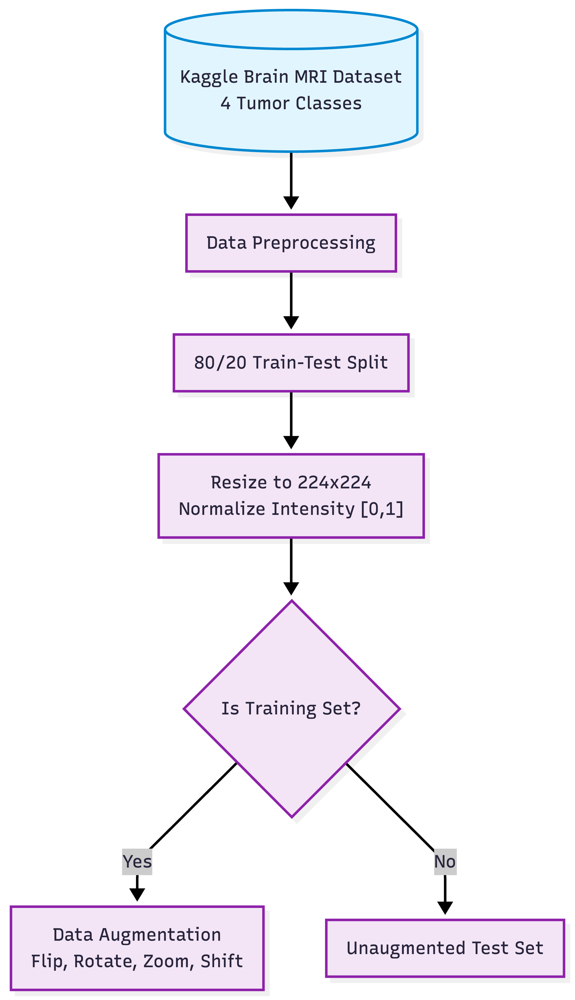
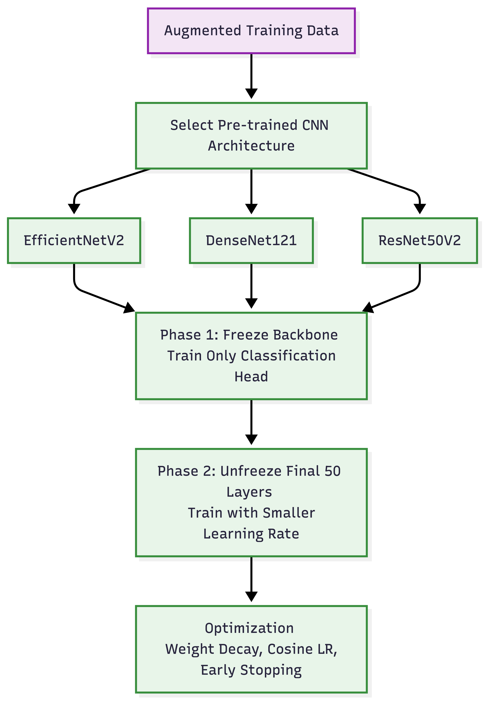
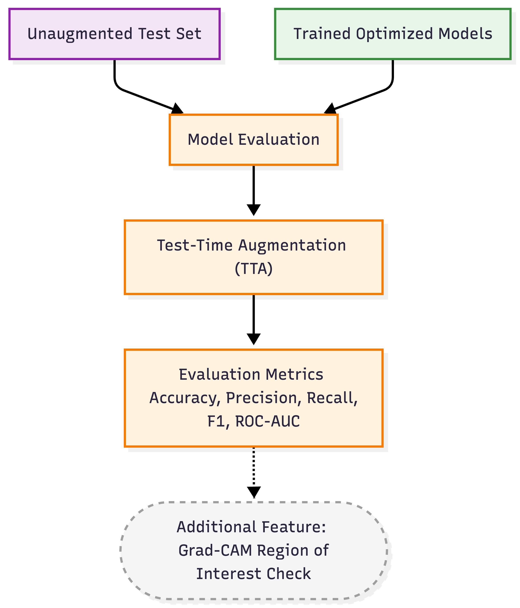
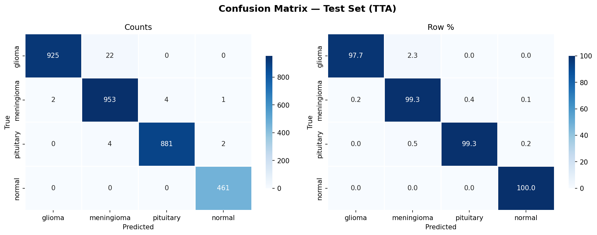
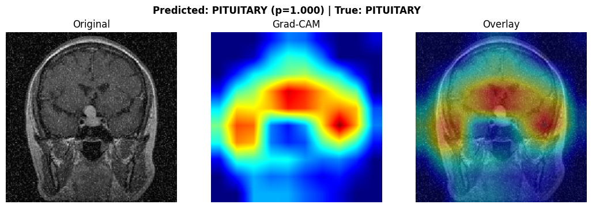
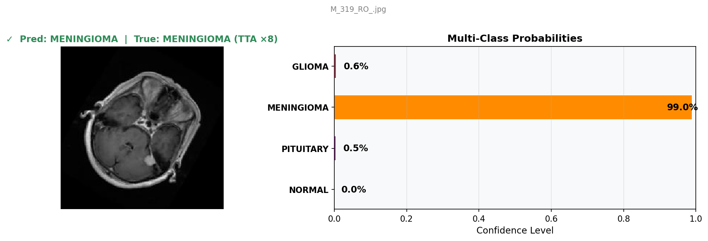
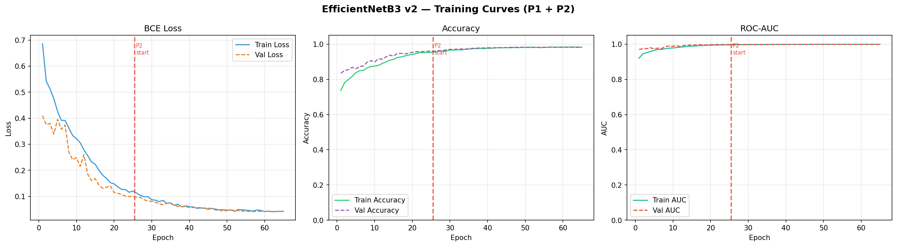
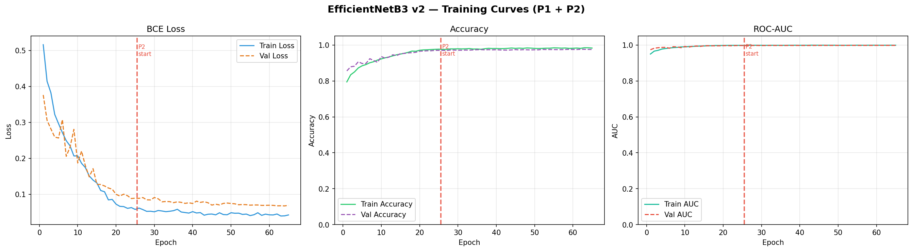
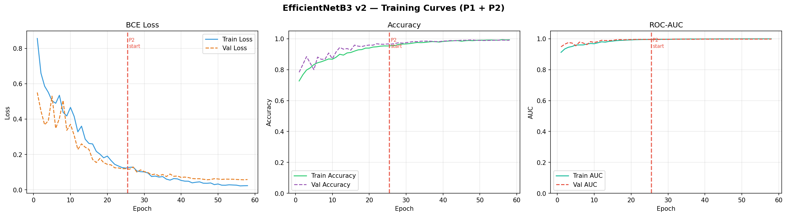

# Comparative Analysis of Advanced CNN Architectures for Multi-Class Brain Tumor Classification Using MRI

[](https://ieeexplore.ieee.org/xpl/conhome/11736170/proceeding)
[](https://doi.org/10.1109/ICONICA70605.2026.11736701)
[](LICENSE)
[](https://www.python.org/)
[](https://www.tensorflow.org/)
[](#visual-interpretability-grad-cam)
[](#experimental-results--benchmark)

> **Official repository for the research paper:**  
> **"Comparative Analysis of Advanced CNN Architectures for Multi-Class Brain Tumor Classification Using MRI"**  
> *Published in the Proceedings of the 2026 IEEE International Conference on Next-Gen Intelligent Computing and Applications (ICONICA 2026)*  
> Paper ID: **597** | Track: **Track 2: Artificial Intelligence and Machine Learning**  
> Digital Object Identifier (DOI): [**10.1109/ICONICA70605.2026.11736701**](https://doi.org/10.1109/ICONICA70605.2026.11736701)  
> Conference Proceedings: [**IEEE Xplore Digital Library**](https://ieeexplore.ieee.org/xpl/conhome/11736170/proceeding) | [**LinkedIn Announcement**](https://lnkd.in/gb45j8Sw)

---

## 👥 Authors & Affiliations

- **Tisha Chhabra** — *Department of Computer Science, CHRIST (Deemed to be University), Bengaluru, India*  
  ORCID: [`0009-0006-9603-0512`](https://orcid.org/0009-0006-9603-0512) | Email: `Chhabratisha9@gmail.com`
- **Dr. Kamal Upreti** — *Department of Computer Science, CHRIST (Deemed to be University), Bengaluru, India*  
  ORCID: [`0000-0003-0665-530X`](https://orcid.org/0000-0003-0665-530X) | Email: `kamalupreti1989@gmail.com`
- **Dr. Varuna Gupta** — *Department of Computer Science, CHRIST (Deemed to be University), Bengaluru, India*  
  ORCID: [`0000-0003-0887-1276`](https://orcid.org/0000-0003-0887-1276) | Email: `varunagupta.cs@gmail.com`

---

## 📌 Executive Summary & Abstract

Early detection and precise characterization of brain tumors are critical determinants of patient prognosis and surgical treatment planning. Magnetic Resonance Imaging (MRI) serves as the primary non-invasive diagnostic modality; however, manual interpretation of complex MRI scans by radiologists is labor-intensive and susceptible to diagnostic variability—particularly because distinct tumor etiologies (e.g., glioma, meningioma, pituitary adenoma) frequently manifest subtle or overlapping morphological features.

This study presents a rigorous comparative benchmark of advanced Convolutional Neural Network (CNN) architectures for automated 4-class brain tumor classification:
1. **Glioma Tumor**
2. **Meningioma Tumor**
3. **Pituitary Tumor**
4. **Normal (Non-tumor healthy brain tissue)**

Using transfer learning initialized from ImageNet weights, we evaluate three representative backbones—**EfficientNetV2 / EfficientNetB3**, **DenseNet121**, and **ResNet50V2**—under identical data processing, custom classification head architectures, and optimization conditions. 

### Key Discoveries:
- **State-of-the-Art Sensitivity**: **EfficientNetV2** attained the premier performance with an accuracy of **98.92%**, a **Macro-AUC of 0.9999**, and the lowest misclassification rate across all tumor categories.
- **Flawless Specificity on Healthy Tissue**: All three fine-tuned architectures achieved **100% recall on normal brain scans**, guaranteeing zero false-negative screenings on healthy individuals.
- **Top 2% Strict ROC Superiority**: In zoomed ROC analysis at strict operating thresholds (low false-positive region), EfficientNetV2 consistently maintained superior true-positive rates compared to DenseNet121 and ResNet50V2.
- **Visual Clinical Interpretability**: Gradient-weighted Class Activation Mapping (**Grad-CAM**) verified that the models' decision-making process was localized strictly to pathological tumor tissue rather than extraneous cranial structures.

---

## 🔬 Methodology & Architecture

The framework incorporates a unified 5-stage pipeline designed for objective backbone comparisons and clinical transparency:

```
[Raw Brain MRI Scans (4 Classes)]
               │
               ▼
   [Data Preprocessing & Augmentation]
   • Intensity Normalization [0, 1]
   • Stratified Split (Train / Val / Test)
   • Rich Affine Augmentation (Rotation, Shift, Zoom, Flip)
               │
               ▼
   [Unified Classification Head Architecture]
   • Pretrained Backbone (ImageNet)
   • Dual Global Pooling (GAP + GMP Concatenation)
   • Batch Normalization
   • Dense Layer (256 units, ReLU, L2 Regularization = 1e-4)
   • Dropout (0.40)
   • Softmax Output (4 Classes)
               │
               ▼
   [Two-Phase Transfer Learning & Optimization]
   • Phase 1: Frozen Backbone (Adam, Peak LR = 3e-3)
   • Phase 2: Unfreeze Top 50 Layers (Peak LR = 1e-5)
   • Cosine Decay Learning Rate Scheduling with Linear Warmup
   • Categorical Label Smoothing (0.10)
               │
               ▼
   [Inference & Interpretability Pipeline]
   • Test-Time Augmentation (TTA ×8 passes)
   • Grad-CAM Heatmap Localization on Convolutional Feature Maps
```

### Architectural Pipeline Diagrams

| Preprocessing & Augmentation | Transfer Learning Architecture | Evaluation & Interpretability |
| :---: | :---: | :---: |
|  |  |  |

---

## 📊 Experimental Results & Benchmark

### Overall Model Performance Comparison

All models were evaluated using 8-fold Test-Time Augmentation (TTA) on unseen test partitions:

| Architecture | Test Accuracy | Macro Precision | Macro Recall | Macro F1-Score | Macro-AUC | Test Support |
| :--- | :---: | :---: | :---: | :---: | :---: | :---: |
| 🥇 **EfficientNetV2** | **98.92%** | **99.01%** | **99.07%** | **99.03%** | **0.9999** | 3,255 |
| 🥈 **DenseNet121** | 98.86% | 98.88% | 99.01% | 98.94% | 0.9995 | 3,255 |
| 🥉 **ResNet50V2** | 99.45% | 99.02% | 98.12% | 98.56% | 0.9995 | 2,383 |

> *Note: For comprehensive benchmarking, test arrays and confusion matrices are archived in [`results/`](results/).*

### Detailed Per-Class Performance Breakdown

#### EfficientNetV2 (Proposed Best Overall Model)
| Class | Precision | Recall | F1-Score | Support |
| :--- | :---: | :---: | :---: | :---: |
| **Glioma Tumor** | **0.9978** | 0.9768 | 0.9872 | 947 |
| **Meningioma Tumor** | 0.9734 | **0.9927** | 0.9830 | 960 |
| **Pituitary Tumor** | 0.9955 | **0.9932** | 0.9944 | 887 |
| **Normal (Healthy Brain)** | 0.9935 | **1.0000** | **0.9968** | 461 |
| **Macro Average** | **0.9901** | **0.9907** | **0.9903** | **3,255** |

#### DenseNet121
| Class | Precision | Recall | F1-Score | Support |
| :--- | :---: | :---: | :---: | :---: |
| **Glioma Tumor** | 0.9968 | 0.9778 | 0.9872 | 947 |
| **Meningioma Tumor** | 0.9734 | 0.9917 | 0.9825 | 960 |
| **Pituitary Tumor** | **0.9977** | 0.9910 | 0.9943 | 887 |
| **Normal (Healthy Brain)** | 0.9872 | **1.0000** | 0.9935 | 461 |
| **Macro Average** | **0.9888** | **0.9901** | **0.9894** | **3,255** |

#### ResNet50V2
| Class | Precision | Recall | F1-Score | Support |
| :--- | :---: | :---: | :---: | :---: |
| **Glioma Tumor** | 0.9722 | 0.9333 | 0.9524 | 75 |
| **Meningioma Tumor** | 0.9907 | 0.9958 | 0.9932 | 960 |
| **Pituitary Tumor** | **0.9977** | 0.9955 | **0.9966** | 887 |
| **Normal (Healthy Brain)** | **1.0000** | **1.0000** | **1.0000** | 461 |
| **Macro Average** | **0.9902** | **0.9812** | **0.9856** | **2,383** |

### Comparative ROC Curves & Macro-AUC


---

## 🔍 Visual Interpretability (Grad-CAM)

To validate model predictions and ensure transparency for clinical adoption, we implemented **Grad-CAM (Gradient-weighted Class Activation Mapping)** on the final convolutional layers. The generated heatmaps illustrate where the model directs its visual attention:

### EfficientNetV2 Visualizations

| Confusion Matrix (TTA) | Grad-CAM Tumor Localization | Single-Image Inference with Confidence Bar |
| :---: | :---: | :---: |
|  |  |  |

### Training & Convergence Curves

| EfficientNetV2 | DenseNet121 | ResNet50V2 |
| :---: | :---: | :---: |
|  |  |  |

---

## 📂 Repository Structure

```
├── .github/
│   ├── ISSUE_TEMPLATE/
│   │   ├── bug_report.md             # Issue template for reproduction bugs
│   │   └── feature_request.md        # Issue template for architectural extensions
│   └── workflows/
│       └── python-lint.yml           # Automated GitHub Action code linting
├── .gitattributes                    # Cross-platform LF line endings & binary specifications
├── .gitignore                        # Git exclusions (checkpoints, OS files, raw datasets)
├── CITATION.cff                      # Native GitHub citation metadata (enables "Cite this repository")
├── citation.bib                      # IEEE BibTeX citation entry for LaTeX / reference managers
├── LICENSE                           # MIT License with academic attribution clause
├── requirements.txt                  # Python dependencies for pip installation
├── environment.yml                   # Conda environment definition for one-click setup
├── README.md                         # Master documentation (this file)
│
├── paper/                            # Official publication artifacts
│   ├── Comparative_Analysis_Advanced_CNN_Brain_Tumor_Classification.pdf  # Published camera-ready paper
│   ├── presentation/
│   │   └── ICONICA_2026_Brain_Tumor_Classification_Slides.pptx          # Conference presentation deck
│   └── certificate/
│       └── ICONICA_2026_Presentation_Certificate_Tisha_Chhabra.pdf      # Presentation certificate
│
├── figures/                          # High-resolution architectural figures & diagrams
│   ├── 01_preprocessing_pipeline.png
│   ├── 02_transfer_learning_architecture.png
│   ├── 03_evaluation_gradcam_workflow.png
│   ├── 04_dataset_samples.png
│   └── 05_roc_curves_comparison.png
│
├── notebooks/                        # Polished, fully reproducible Jupyter Notebooks
│   ├── 01_EfficientNetV2_Brain_Tumor_Classification.ipynb  # Primary proposed model
│   ├── 02_DenseNet121_Brain_Tumor_Classification.ipynb     # DenseNet121 comparative baseline
│   └── 03_ResNet50V2_Brain_Tumor_Classification.ipynb      # ResNet50V2 comparative baseline
│
├── src/                              # Production-grade modular Python package
│   ├── __init__.py                   # Package initialization
│   ├── models.py                     # Model builders (EfficientNet, DenseNet, ResNet + Dual Pooling)
│   ├── data_loader.py                # Stratified splitting and ImageDataGenerators
│   ├── lr_scheduler.py               # Cosine decay schedule with linear warmup
│   ├── gradcam.py                    # Grad-CAM heatmap computation & overlay
│   ├── evaluate.py                   # TTA evaluation, confusion matrices, classification reports
│   └── predict.py                    # Standalone CLI inference & visualization script
│
└── results/                          # Complete quantitative outputs and test arrays
    ├── benchmark_summary.json        # Machine-readable benchmark comparison
    ├── efficientnetv2/
    │   ├── classification_report.txt
    │   ├── confusion_matrix.png
    │   ├── gradcam.png
    │   ├── inference_result.png
    │   ├── training_curves.png
    │   ├── efficientnetv2_report.json
    │   └── efficientnetv2_metrics.npz
    ├── densenet121/
    │   ├── classification_report.txt
    │   ├── confusion_matrix.png
    │   ├── gradcam.png
    │   ├── inference_result.png
    │   ├── training_curves.png
    │   ├── densenet121_report.json
    │   └── densenet121_metrics.npz
    └── resnet50v2/
        ├── classification_report.txt
        ├── confusion_matrix.png
        ├── gradcam.png
        ├── inference_result.png
        ├── training_curves.png
        ├── resnet50v2_report.json
        └── resnet50v2_metrics.npz
```

---

## 🚀 Quickstart & Setup Guide

### 1. Clone the Repository

```bash
git clone https://github.com/Tisha-Chhabra/Brain-Tumor-Classification-CNN-MRI.git
cd Brain-Tumor-Classification-CNN-MRI
```

### 2. Environment Setup

#### Option A: Using Conda (Recommended)

```bash
conda env create -f environment.yml
conda activate brain-tumor-dl
```

#### Option B: Using Pip & Virtualenv

```bash
python -m venv .venv

# On Linux/macOS:
source .venv/bin/activate
# On Windows:
.venv\Scripts\activate

pip install --upgrade pip
pip install -r requirements.txt
```

---

## 💾 Dataset Acquisition

The models were evaluated on the publicly available **Brain Tumor MRI Dataset** from Kaggle:
- **Kaggle Dataset**: [Brain Tumors Dataset by Mohammad Hossein](https://www.kaggle.com/datasets/mohammadhossein77/brain-tumors-dataset)

### Organizing Dataset Directories
Organize your uncompressed dataset into four category directories:
```
clean_dataset/
├── glioma/
├── meningioma/
├── pituitary/
└── normal/
```

To automatically split the dataset into stratified `train` (70%), `val` (15%), and `test` (15%) sets:

```python
from src.data_loader import split_dataset

split_dataset(
    src_root="./clean_dataset",
    dst_root="./split_data",
    classes=["glioma", "meningioma", "pituitary", "normal"],
    train_r=0.70,
    val_r=0.15,
    test_r=0.15,
    seed=42
)
```

---

## 💻 Running the Code

### 1. Interactive Notebooks (Kaggle / Colab / Local)

Launch JupyterLab:
```bash
jupyter lab
```
Navigate to the `notebooks/` directory and open:
- `01_EfficientNetV2_Brain_Tumor_Classification.ipynb` to train and evaluate the premier model.
- `02_DenseNet121_Brain_Tumor_Classification.ipynb` for the DenseNet121 baseline.
- `03_ResNet50V2_Brain_Tumor_Classification.ipynb` for the ResNet50V2 baseline.

### 2. Command-Line Inference (CLI)

Run inference on any MRI scan image using the provided CLI tool:

```bash
# Basic prediction with class confidence bar
python src/predict.py --image path/to/mri_scan.jpg --architecture efficientnet

# Prediction + Grad-CAM heatmap visualization overlay
python src/predict.py --image path/to/mri_scan.jpg --architecture efficientnet --gradcam --output_dir ./outputs
```

Output:
```text
=============================================
       BRAIN TUMOR MRI PREDICTION
=============================================
Top Prediction : GLIOMA (99.78%)
---------------------------------------------
Class Probabilities:
  glioma       :  99.78% | ██████████████████████████████
  meningioma   :   0.14% | 
  pituitary    :   0.05% | 
  normal       :   0.03% | 
=============================================
```

### 3. Programmatic Python API

Import and instantiate model architectures in your own scripts:

```python
from src.models import build_model, unfreeze_backbone

# Instantiate model with dual pooling and ImageNet weights
model, backbone = build_model(
    architecture="efficientnet",
    num_classes=4,
    input_shape=(300, 300, 3),
    weight_decay=1e-4,
    dropout_rate=0.40
)

# Unfreeze top 50 layers for Phase 2 fine-tuning
unfreeze_backbone(backbone, num_layers_to_unfreeze=50)
```

---

## 📖 Citation

If you use this repository, the model architectures, experimental benchmarks, or findings in your academic research, please cite our paper:

### BibTeX
```bibtex
@inproceedings{chhabra2026comparative,
  author    = {Chhabra, Tisha and Upreti, Kamal and Gupta, Varuna},
  title     = {Comparative Analysis of Advanced CNN Architectures for Multi-Class Brain Tumor Classification Using MRI},
  booktitle = {2026 IEEE International Conference on Next-Gen Intelligent Computing and Applications (ICONICA)},
  year      = {2026},
  pages     = {1--6},
  address   = {Bengaluru, India},
  publisher = {IEEE},
  doi       = {10.1109/ICONICA70605.2026.11736701},
  url       = {https://doi.org/10.1109/ICONICA70605.2026.11736701}
}
```

### IEEE Format
> T. Chhabra, K. Upreti, and V. Gupta, "Comparative Analysis of Advanced CNN Architectures for Multi-Class Brain Tumor Classification Using MRI," in *2026 IEEE International Conference on Next-Gen Intelligent Computing and Applications (ICONICA)*, Bengaluru, India, 2026, pp. 1–6. DOI: [10.1109/ICONICA70605.2026.11736701](https://doi.org/10.1109/ICONICA70605.2026.11736701).

---

## 📜 License

This project is open-source under the [**MIT License**](LICENSE).  
The published research paper and presentation materials are shared for academic research, education, and peer verification.

---

## 🤝 Acknowledgments

- Department of Computer Science, CHRIST (Deemed to be University), Bengaluru, India.
- Organizers, Technical Committee, and Reviewers of IEEE ICONICA 2026.
- The open-source medical imaging and deep learning communities (TensorFlow, Keras, Kaggle).

---

*For queries, issues, or collaborative research, feel free to open an issue or reach out to `Chhabratisha9@gmail.com`.*
